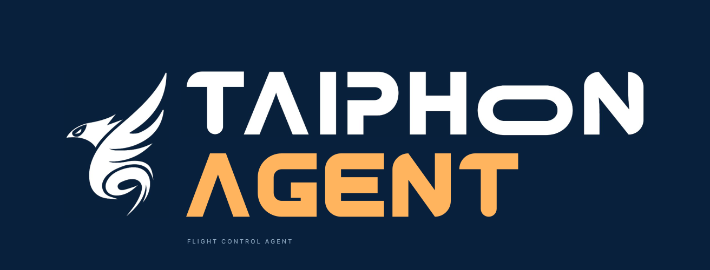
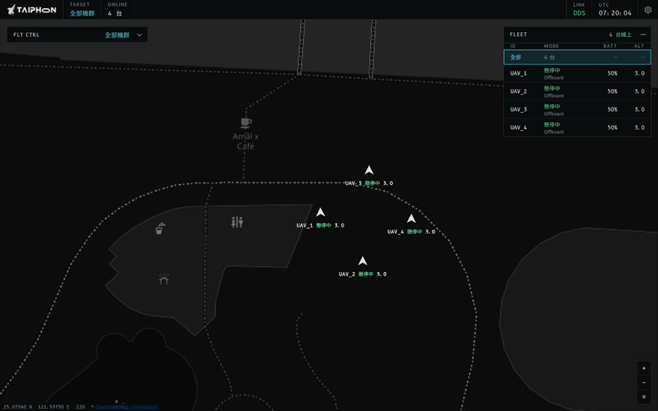
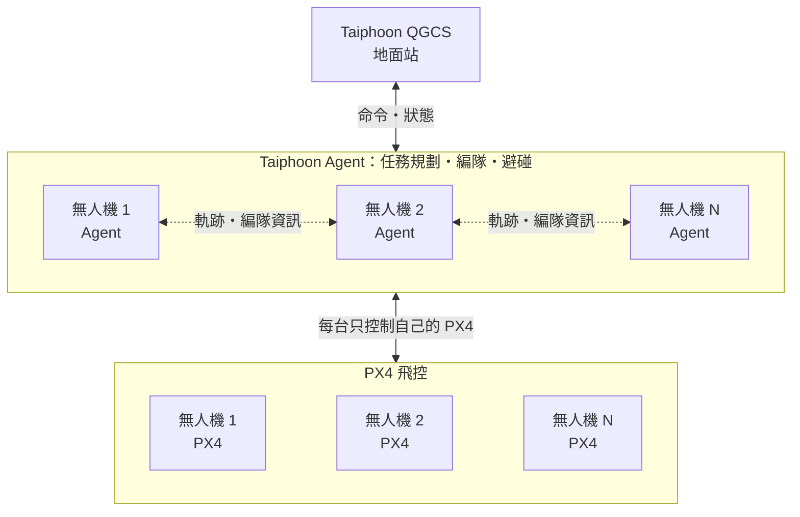

<p align="center">
  
</p>

<p align="center">
  <a href="https://github.com/Rex-Taiphoon/Taiphoon_Agent/releases"></a>
  <a href="#下載"></a>
  <a href="https://github.com/Rex-Taiphoon/Taiphoon_QGCS"></a>
  <a href="#授權"></a>
</p>

**Taiphoon Agent** 是在每台無人機上執行的機載程式，與 Taiphoon QGCS 搭配組成機群控制系統，負責與 PX4 飛控溝通，並處理任務規劃、編隊與機間避碰。下載平台套件後一個指令就能啟動，不需安裝 ROS2 或自行編譯；同一套工具可以裝在無人機的樹莓派上飛實機，也能在電腦上啟動 1～4 台模擬無人機。

<!-- 主視覺預留位置：終端機錄影 GIF（docs/images/quickstart.gif），從執行 taiphoon_agent、首次設定選 sim → 4 組，到啟動成功。
<p align="center">
  
</p>
-->

## 特色

- **一個指令啟動**：下載並解壓縮後執行 `taiphoon_agent` 即可，不需安裝 ROS2，也不必自行編譯。
- **實機與模擬共用**：樹莓派實機與電腦上的模擬機群使用同一套工具，首次設定後，之後一鍵啟動。
- **多機自動編隊與避碰**：Agent 之間互相交換接下來的飛行軌跡，依總移動距離最短自動分配隊形位置，並保持機間安全距離。
- **成員離線自動重組**：有 Agent 離線時，其餘成員自動重組隊形；只剩 1 台時解散編隊並原地懸停。
- **安全預設**：啟動時不會解鎖或起飛；缺少障礙物地圖或多機時間未同步時，無人機原地等待，不會貿然移動。
- **多平台套件**：提供 Raspberry Pi、Linux、Windows 與 macOS 的完整套件，內含預先編譯好的 Agent 映像。

## 實際執行

<!-- 終端機畫面預留位置：
### 一個指令啟動

<p align="center">
  
</p>

首次執行時選擇模式與數量，Agent 隨即啟動；之後只要執行 `taiphoon_agent` 就會沿用同一份設定。畫面下方的倍速標示為剪輯時加速的段落。
-->

### 機群同時起飛

<p align="center">
  
</p>

收到全機群起飛命令後，4 台 Agent 各自讓 PX4 起飛到 3 公尺並懸停。畫面為 Taiphoon QGCS。

### 環形與燕行編隊

<p align="center">
  
</p>

Agent 依總移動距離最短自動分配位置並避碰，先排成半徑 15 公尺的環形編隊，再變換為燕行編隊（V 字，頂點朝北）。畫面為 Taiphoon QGCS；畫面下方的倍速標示為剪輯時加速的段落。

### 成員離線自動重組

<p align="center">
  
</p>

編隊中有 1 台 Agent 離線後，其餘 3 台確認成員變動，自動重新分配位置組成新的環形編隊，存活成員只做最短的移動。畫面為 Taiphoon QGCS；畫面下方的倍速標示為剪輯時加速的段落。

<!-- 更多畫面預留位置：status、logs 終端機截圖
### 更多畫面

| 狀態查詢 | 日誌 |
|:---:|:---:|
|  |  |
-->

> 以上畫面取自 4 台模擬無人機（PX4 SITL）；地圖資料 © OpenStreetMap contributors。

## 下載

選擇你的平台下載最新版本，或到 [Releases 頁面](https://github.com/Rex-Taiphoon/Taiphoon_Agent/releases)查看所有檔案：

<p align="center">
  <a href="https://github.com/Rex-Taiphoon/Taiphoon_Agent/releases"></a>
  <a href="https://github.com/Rex-Taiphoon/Taiphoon_Agent/releases"></a>
  <a href="https://github.com/Rex-Taiphoon/Taiphoon_Agent/releases"></a>
  <a href="https://github.com/Rex-Taiphoon/Taiphoon_Agent/releases"></a>
</p>

- **Raspberry Pi（64 位元 Ubuntu 22.04）**：`linux-arm64.tar.gz`，解壓縮後執行 `./taiphoon_agent`；需先安裝 Docker Engine 與 Compose plugin。
- **Linux（Ubuntu 22.04，Intel／AMD）**：`linux-amd64.tar.gz`，解壓縮後執行 `./taiphoon_agent`；需先安裝 Docker Engine 與 Compose plugin。
- **Windows（Intel／AMD 64 位元）**：`windows-amd64.zip`，解壓縮後按兩下 `taiphoon_agent.exe`；需先安裝 Docker Desktop。
- **macOS（Apple Silicon／Intel）**：Apple Silicon 選 `macos-arm64.tar.gz`、Intel 選 `macos-amd64.tar.gz`，解壓縮後按兩下 `Start Taiphoon Agent.command`；需先安裝 Docker Desktop。

<details>
<summary>安裝注意事項</summary>

- **安裝到使用者目錄（選用）**：Linux／macOS 在套件目錄執行 `bash install.sh`，Windows 執行 `./install.ps1`，之後在任何位置都能直接輸入 `taiphoon_agent`。沒有安裝時，Linux／macOS 在指令前加 `./`，Windows 使用 `./taiphoon_agent.exe`。更新既有的 Agent 也使用 `install.sh`，見[安裝與更新](#安裝與更新)。
- **macOS**：套件尚未經 Apple 公證，第一次開啟會被系統阻擋。到「系統設定 → 隱私權與安全性」按「強制打開」即可，不需要停用安全機制。
- **Windows**：找不到 Docker 時，先開啟 Docker Desktop；工具會自動尋找 PATH 與標準安裝位置。只安裝在 WSL Ubuntu 內的 Docker 無法使用，請改用 Docker Desktop。
- **Docker Desktop**：請使用 Linux 容器模式。
- **版本一致**：啟動工具與映像請整包下載同一個版本，不要混用不同版本的檔案。

</details>

## 快速開始

1. 安裝並開啟 Docker：Ubuntu 使用 Docker Engine 與 Compose plugin，Windows／macOS 使用 Docker Desktop。
2. 從 [Releases 頁面](https://github.com/Rex-Taiphoon/Taiphoon_Agent/releases)下載對應平台的套件並解壓縮。要使用模擬模式時，先執行一次：
   ```bash
   docker network create Taiphoon_Net
   ```
3. 執行 `taiphoon_agent`（Windows 按兩下 `taiphoon_agent.exe`，macOS 按兩下 `Start Taiphoon Agent.command`），首次執行會出現設定。
4. 實機選 `deploy` 並輸入無人機編號；想先在電腦上試用，選 `sim` 並輸入組數（1～4）。看到「服務程序已啟動；不會自動 Arm／起飛。」就代表啟動完成。
5. 照啟動器最後印出的提示開啟 [Taiphoon QGCS](https://github.com/Rex-Taiphoon/Taiphoon_QGCS)，即可看到機群並下達命令。

## 使用說明

### 三種模式

- **deploy（實機）**：在無人機的樹莓派上啟動一個 Agent，透過 Wi-Fi 連線飛控。首次設定輸入無人機編號（需與飛控 system ID 一致），QGCS 電腦的 IP 可選填。
- **sim（模擬）**：在電腦上啟動 1～4 組模擬無人機，每組包含一個 PX4 模擬器與一個 Agent。首次設定輸入組數，QGCS 在其他電腦時可選填該電腦的 IP。
- **dev（開發）**：給開發者從原始碼編譯後執行，見 [開發與驗證指南](docs/development.md)。

設定儲存後，之後只要執行 `taiphoon_agent` 就會沿用。要切換模式或機數，依序執行 `taiphoon_agent stop`、`taiphoon_agent config`、`taiphoon_agent start`。

- 工具不會自動解鎖或起飛；實機模式不會啟動任何模擬感測器。
- 不要讓實體飛控連到 sim 模式的 Agent，也不要同時執行相同無人機編號與 ROS domain 的模擬及實機。
- 第一次使用 sim 會自動下載 PX4 模擬器映像，需要網路。在樹莓派等 ARM64 主機上執行模擬時，PX4 模擬器以 AMD64 模擬執行，Docker 需要支援 CPU 模擬。

### 常用指令

| 指令 | 用途 |
|---|---|
| `taiphoon_agent` | 使用已儲存的設定啟動，等同 `start` |
| `taiphoon_agent stop` | 停止服務，保留設定與資料 |
| `taiphoon_agent restart` | 重新取得目前網路並重新啟動；更換 Wi-Fi 或主機 IP 改變後使用 |
| `taiphoon_agent status` | 查看各 Agent 的健康狀態與 PX4 連線 |
| `taiphoon_agent logs` | 查看最近的日誌 |
| `taiphoon_agent config` | 切換模式或機數（需先 `stop`） |
| `taiphoon_agent timesync` | 檢查本機對時狀態（實機多機） |

沒有安裝到使用者目錄時，Linux／macOS 在指令前加 `./`，Windows 使用 `./taiphoon_agent.exe`。

### 安裝與更新

在樹莓派等 Linux 主機（macOS 相同）解壓縮新版套件後執行 `install.sh`；首次安裝與更新既有的 Agent 都用同一個指令，執行前會列出計畫並詢問：

```bash
mkdir taiphoon_agent-new
tar -xzf taiphoon_agent-<版本>-linux-arm64.tar.gz -C taiphoon_agent-new
bash taiphoon_agent-new/install.sh
```

- **保留設定**：沿用原本的 `settings.ini`；原本手動指定其他設定目錄或用 systemd 服務啟動的部署，也會一併接手。
- **縮短停機**：舊版仍在執行時先載入新版映像，再停止舊版、啟動新版並等待就緒；原本沒有執行的 Agent 更新後維持停止。
- **失敗自動切回**：新版啟動失敗時自動切回上一版並恢復執行；之後也能手動切回：`bash ~/.local/share/taiphoon_agent/install.sh --rollback`。
- **開機自動啟動**：加上 `--autostart` 設定 systemd 服務 `taiphoon-agent`，之後用 `sudo systemctl restart taiphoon-agent`／`stop` 管理；`--no-autostart` 取消。
- **一次完成實機首次安裝**：`bash install.sh --yes --agent-id 2 --autostart`（無人機 2），`--yes` 表示不詢問。
- 只保留目前與上一個版本；舊版 Docker 映像不會自動刪除。
- Linux 實機沒有安裝 chrony 且 `settings.ini` 未設定 `time_sync=off` 時，新版一定無法啟動，因此更新會在停止舊版前先中止；請先完成[多機對時](#多機對時)。
- 不要加 `sudo` 執行；需要管理 systemd 時腳本會自行詢問 sudo 密碼。

### 實機必要設定

進階設定都在 `settings.ini`：Windows 位於 `%LOCALAPPDATA%\TaiphoonAgent\config\`，Linux／macOS 位於 `~/.config/taiphoon_agent/`。完整欄位與串列埠連線方式見 [平台套件說明](Tools/agent_launcher/PACKAGE-README.md)。

#### 飛控連線

實機預設飛控 IP 為 `192.168.1.14`，這是飛控的位址，不是 Agent 主機；不同時請修改 `settings.ini` 的 `flight_ip`。Agent 主機的 IP 每次啟動自動取得，啟動時會印出飛控需要連線的埠號。請先在飛控 console 讓 uXRCE-DDS client 連向 Agent 主機，例如無人機 1：

```sh
uxrce_dds_client start -t udp -h <Agent 主機 IP> -p 8888 -n uav_1
```

無人機 N 使用埠 `8887 + N` 與 `uav_N`，飛控的 system ID 必須與無人機編號一致。啟動工具不會修改飛控參數。

#### 多機對時

多機實機飛行**必須先對時**：各台主機時間相差超過 1 秒時，Agent 會拒收其他成員的軌跡，移動與編隊都會原地等待。樹莓派沒有內建時鐘，開機時間常常不準，因此每台都要對時。對時不需要地面站，由無人機 1 的樹莓派當時間主機，每台只需設定一次（`setup_time_sync.sh` 在 Linux 套件根目錄）：

```bash
sudo bash setup_time_sync.sh master
```

其他無人機的樹莓派執行下列指令（建議在路由器為無人機 1 綁定固定 IP）：

```bash
sudo bash setup_time_sync.sh client <無人機 1 的 IP>
```

每次飛行先開無人機 1，再開其他無人機。Linux 實機的 `taiphoon_agent start` 會先確認已對時，最多等待 60 秒，未就緒就停止啟動；也可以用 `taiphoon_agent timesync` 單獨檢查。單機飛行可在 `settings.ini` 設定 `time_sync=off`。

#### 障礙物地圖

Agent 只有在有障礙物地圖時才會移動。實機預設 `obstacle_source=none`：起飛、懸停、旋轉與降落正常，但單機移動、編隊移動與全體移動會原地等待，狀態顯示 `Required obstacle map is missing`。已確認場地淨空時，可在 `settings.ini` 宣告：

```text
obstacle_source=explicit_empty
```

宣告後 Agent 只做機間避碰，**不會避開實體障礙物**，每次啟動都會顯示警告。模擬模式不受此設定影響。

### 編隊與安全距離

- 編隊與機間避碰預設保持機體中心至少 2 公尺。這個距離不會限制場域邊界、飛行高度或 PX4 返航（RTL）路徑，起飛前請自行確認場地。
- 編隊至少需要 2 台無人機，編隊高度以起飛點（Home）為基準。
- 降落或上鎖後，Agent 會清除編隊與移動目標；在地面下達的移動或編隊命令不會保留到起飛後，再次起飛後要重新下達編隊。
- 有 Agent 離線時，其餘成員自動重組；飛行中重新啟動的 Agent 要重新下達編隊才會加入，期間其他成員維持目前隊形。

### 與 Taiphoon QGCS 連線

在 Windows／macOS 執行 sim 時，啟動成功後啟動器會印出 Taiphoon QGCS 的啟動參數，照著執行即可，例如：

```powershell
Taiphoon_QGCS.exe --interface <主機區網 IP> --external-address 192.168.65.254 --no-multicast --peer <主機區網 IP> --participant-index 50
```

- **QGCS 在另一台電腦**：執行 `taiphoon_agent config` 選 sim 後填入該電腦的 IP（多台以逗號分隔，輸入 `-` 清除），啟動器會另外印出該電腦用的參數；該電腦需允許 UDP 7510、7511 連入。
- **實機**：QGCS 與無人機連上同一個 Wi-Fi、使用相同的 ROS domain（預設 0）即可自動找到 Agent；網路阻擋自動探索時，用 `taiphoon_agent config` 填入 QGCS 電腦的 IP。
- 主機 IP 改變（例如更換 Wi-Fi）後，執行 `taiphoon_agent restart`，再依新印出的參數重新開啟 QGCS。主機有多張網卡而取錯 IP 時，在 `settings.ini` 設定 `lan_address`。

QGCS 的操作方式見 [Taiphoon QGCS](https://github.com/Rex-Taiphoon/Taiphoon_QGCS)。

### 狀態與日誌

- `taiphoon_agent status` 會列出各容器狀態，並逐台顯示是否已收到有效的 PX4 狀態。容器顯示 `healthy` 或已收到 PX4 狀態，都不代表可以起飛，仍需確認定位與感測器。
- `taiphoon_agent logs` 顯示最近 150 行日誌，啟動失敗時先看這裡。飛控尚未連線不會阻止 Agent 啟動，可用 `status` 確認是否已收到 PX4 狀態。
- 執行 `stop` 或 Agent 關閉後，容器會被移除，舊日誌就查不到了；需要保留時請先匯出，例如：

```bash
taiphoon_agent logs > agent.log
```

## 系統架構



每台無人機上的 Taiphoon Agent 只控制自己的 PX4 飛控。多機協作時，Agent 之間透過區網交換規劃好的飛行軌跡與編隊資訊，各自規劃避開其他成員的路徑；Taiphoon QGCS 負責送出命令與顯示機群狀態。

## 連結

- [下載最新版本](https://github.com/Rex-Taiphoon/Taiphoon_Agent/releases)：各平台套件與版本說明
- [平台套件說明](Tools/agent_launcher/PACKAGE-README.md)：`settings.ini` 進階設定、串列埠連線與疑難排解
- [Taiphoon QGCS](https://github.com/Rex-Taiphoon/Taiphoon_QGCS)：搭配使用的地面站

## 授權

MIT，見 [LICENSE](LICENSE)。Agent 映像另含 ROS 2（Apache-2.0）、Eclipse Cyclone DDS（EPL-2.0／EDL-1.0）、Micro XRCE-DDS Agent（Apache-2.0）與 px4_msgs（BSD-3-Clause）等第三方元件，依各自的授權條款提供。
